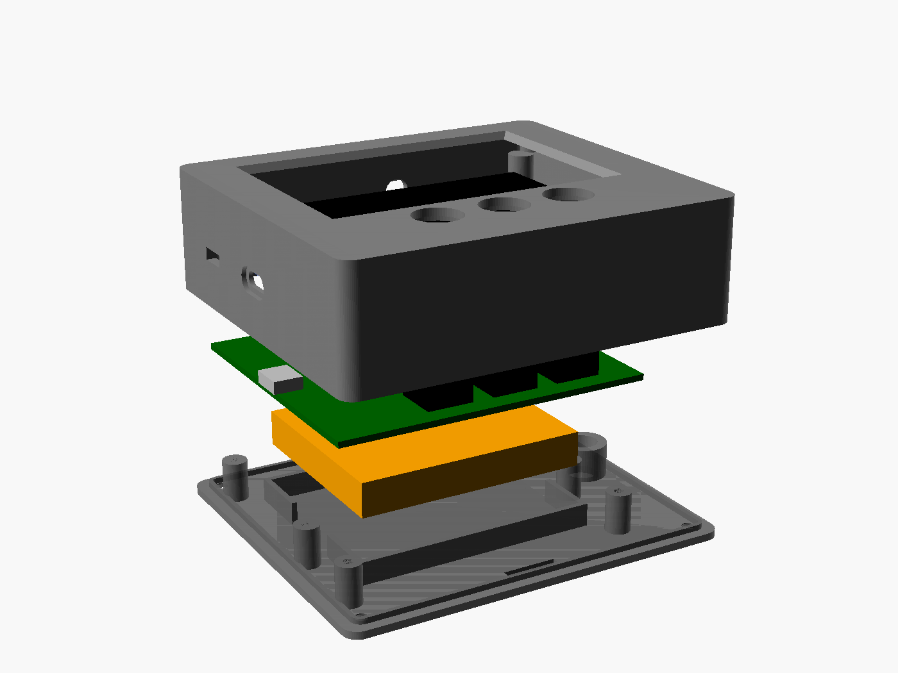
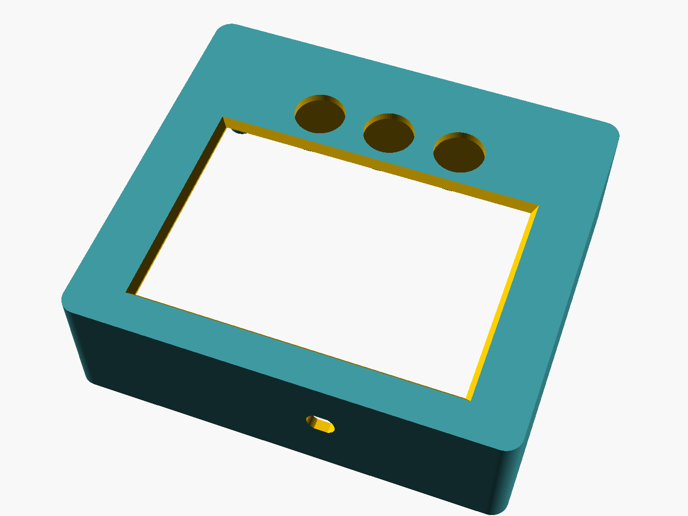
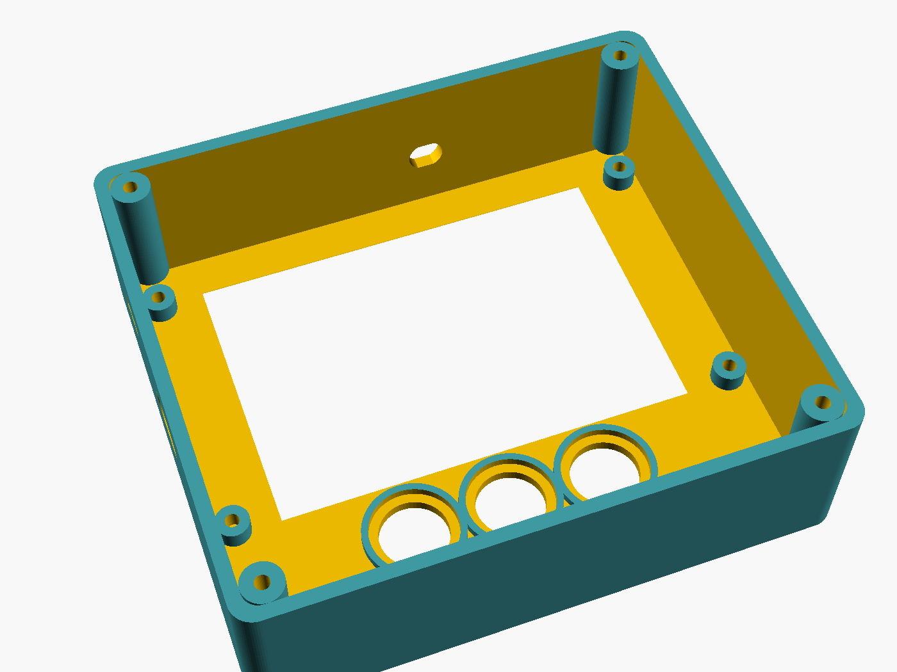
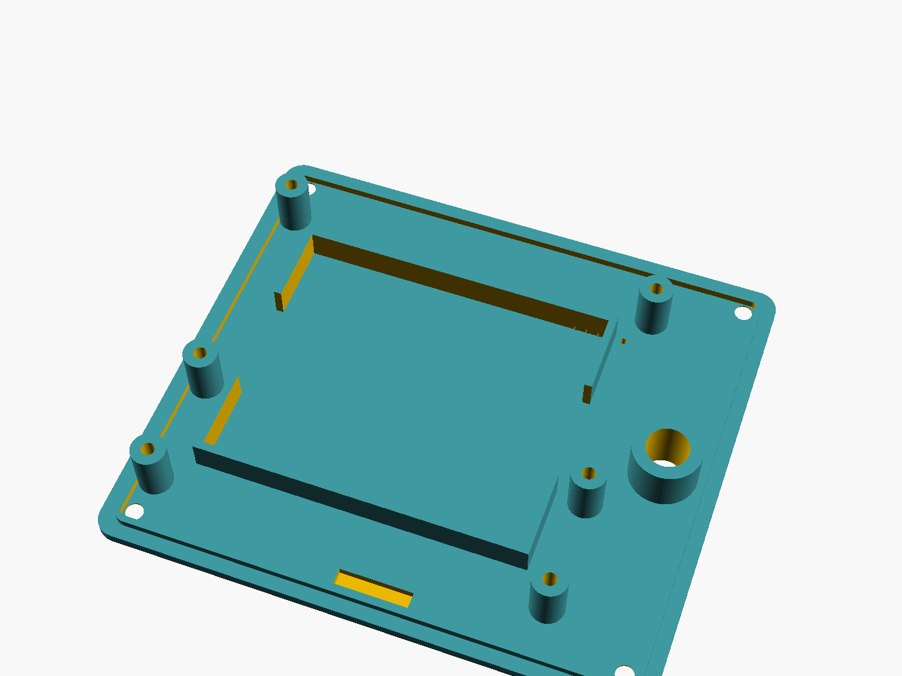
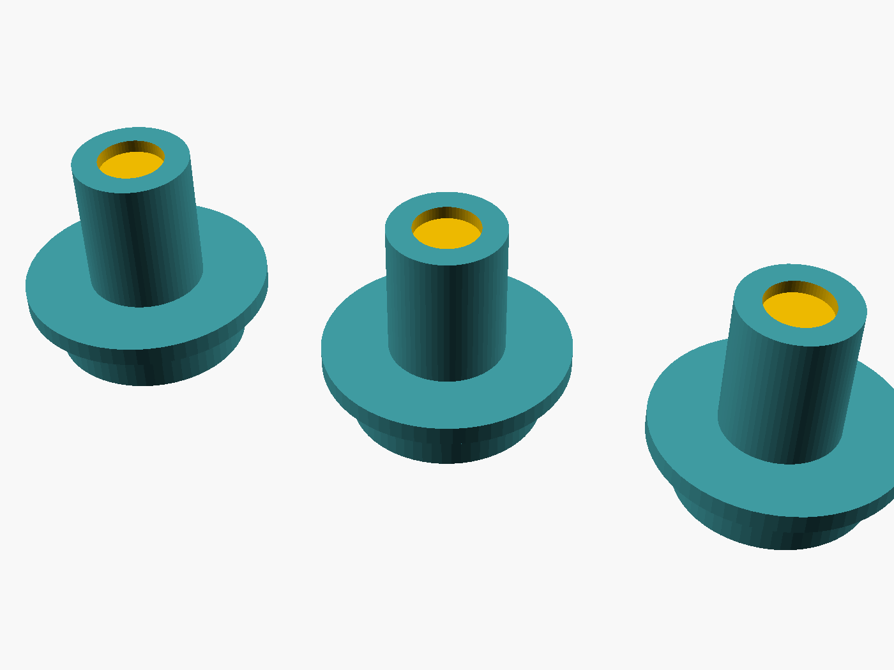

# Radio Thing — display unit enclosure

Parametric OpenSCAD model (`radio_thing_display.scad`) for the DISPLAY build of the rev A board: front shell, back lid and 3 button caps. Ready-to-print STLs are in `stl/`, pictures in `previews/`.

Outer size: **103.8 × 92.3 × 33.3 mm** (W × H × D).



| Front (outside) | Front (inside) | Lid (inside) | Button caps |
|---|---|---|---|
|  |  |  |  |

## How it fits together

- **Front shell:** screen window with a 45° bevel, 3 button holes, 4 bosses that the screen module screws onto from behind, 4 lid-screw columns, cut-outs for USB-C and the power switch (left wall), and a hole for the SMA antenna bulkhead (top wall).
- **Screen:** the lcdwiki MSP3525 module sits against the inside of the front plate. The module is 98 mm wide and the board is 82 mm, so the screen connects to the board's J3 socket through a **short 14-wire ribbon** (2.54 mm pitch, male→female, ~10 cm), not by plugging in directly. That's what lets the screen sit centred while the board's USB-C reaches the left wall.
- **Board:** screws onto 6 posts on the **lid** (M3 × 6 self-tapping, through the board's mounting holes). The board is behind the screen with its components facing it.
- **Battery:** sits in the rib pocket on the lid, behind the board (60 × 50 × ≤9 mm, e.g. a 2000 mAh 805060 cell).
- **Lid:** closes with 4 × M3 countersunk screws into the front shell columns. A tongue locates it and helps keep splashes out.
- **Button caps:** each cap's head pokes through the front, its flange stops it falling out, and its stem presses the 12 × 12 mm tactile switch. The caps are engraved ▲ ● ▼.
- **Lid extras:** a 1/4"-20 tripod insert boss, a wrist-strap slot, and buzzer vent holes.

## Measure first (values marked `[MEASURE]` at the top of the .scad)

| Parameter | Default | What to measure |
|---|---|---|
| `DISP_T` | 5.2 | screen module thickness: glass front → module PCB back, without header pins |
| `DISP_GLASS_T` | 3.6 | glass + backlight thickness in front of the module PCB (sets the boss height) |
| `AA_DX`, `AA_DY` | 0, 0 | how far the visible area's centre sits from the module PCB's centre |
| `BATT_T` | 10 | battery thickness + wiring |
| `SW_H` | 7.3 | your 12 × 12 tactile switch height including plunger (sets cap stem length) |

Then re-export:
```sh
for p in front lid caps; do openscad -D "part=\"$p\"" -o stl/radio_thing_$p.stl radio_thing_display.scad; done
openscad -D 'part="assembly"' radio_thing_display.scad      # visual check in the GUI
```

## Printing

| Part | Orientation | Settings |
|---|---|---|
| Front shell | front face **down** | PETG or ASA (PLA warps in a hot car), 0.2 mm layers, 4 walls, 25% infill, no supports needed |
| Lid | outside face **down** | same |
| Button caps | head down (as exported) | 0.12 mm layers, 100% infill, a contrasting colour fills the engraved symbols nicely |

Print one cap first and test-fit it in the front shell. The hole is 12.3 mm for an 11.6 mm head, so adjust `CAP_HOLE_D` if your printer runs tight or loose.

## Hardware

| Qty | Part |
|---|---|
| 6 | M3 × 6 self-tapping (or M3 × 6 machine + M3 heat-set inserts: set post pilot to 4.0 mm) — board to lid |
| 4 | M3 × 8 countersunk — lid to front shell |
| 4 | M3 × 5 (or M2.5) — screen module to front bosses |
| 1 | 1/4"-20 heat-set insert, 8 mm OD (optional, tripod) |
| 1 | 14-pin 2.54 mm ribbon / Dupont jumper set, male→female, ~10 cm — screen to J3 |
| 1 | U.FL → SMA bulkhead pigtail (~10 cm) + 2.4 GHz SMA antenna |

## Assembly order

1. Screw the screen module onto the 4 front bosses (glass toward the window).
2. Drop the 3 button caps into their holes from the inside.
3. Plug the ribbon onto the screen's header pins.
4. Fit the SMA bulkhead in the top wall and connect the pigtail to the ESP32 module's U.FL.
5. Screw the board onto the lid posts. Plug in the battery and seat it in the pocket.
6. Connect the ribbon to J3. Close the lid (the button switches land under the cap stems) and fit the 4 lid screws.

## Not covered yet

- **Sensor pod enclosure:** drone/GoPro mount, magnet, VHB pad, radar-head window. It's next, once the radar head board is decided.
- **Gasket groove:** splash resistance is a lip-and-tongue joint only. Add a TPU gasket if you need more.
