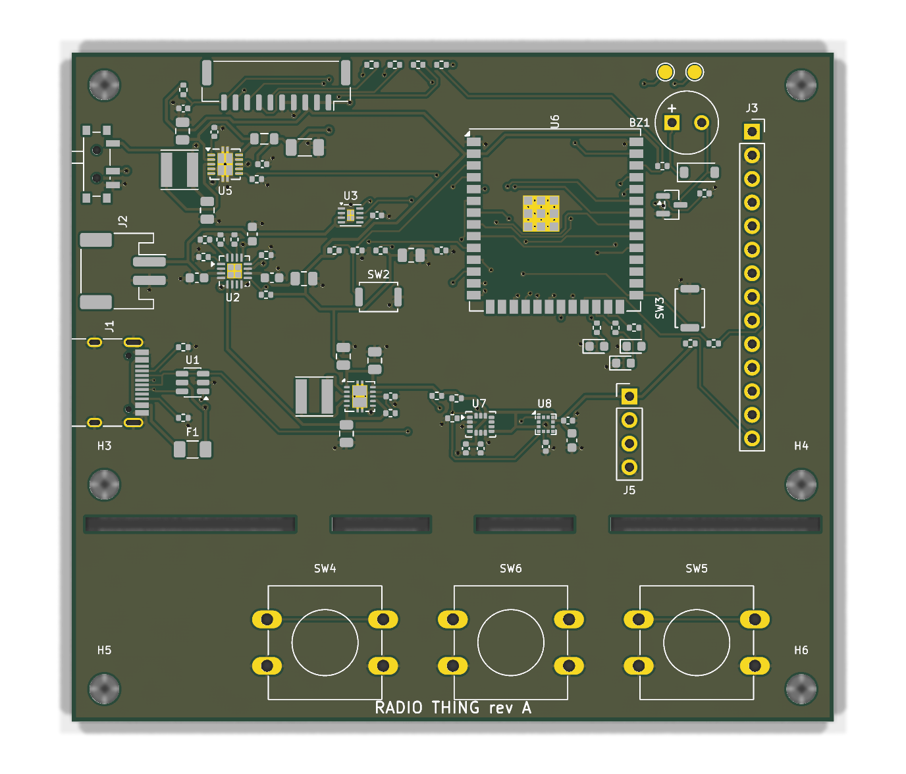
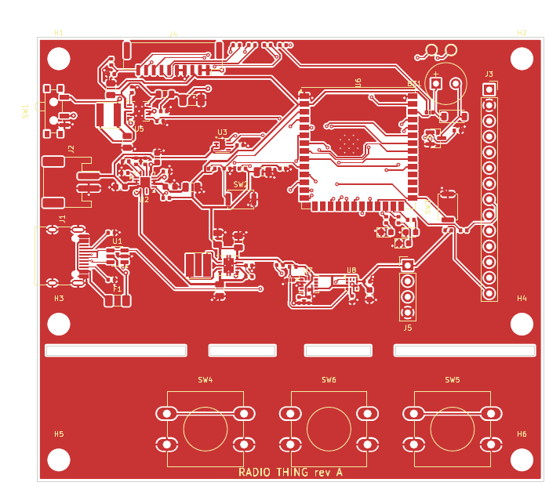

# Radio Thing — main board, rev A (KiCad 9)

One PCB for both builds:

- **POD:** 82 × 50 mm. Cut the button tab off at its 5 small bridges (flush cutters or a saw, then sand).
- **DISPLAY:** 82 × 72 mm. Keeps the tab with 3 buttons (UP · OK · DOWN) centred right under the screen.





## Status

| Step | State |
|---|---|
| Schematic | ✅ Generated, KiCad ERC: 1 warning (unused IMU aux pin tied to GND, expected) |
| Netlist | ✅ 304 pin assignments verified against `design.py`, 30 MCU pins verified against `firmware/include/board_pins.h` |
| PCB placement | ✅ Power stages and sensors placed tight around their IC pins; every pad on its net. |
| PCB routing | ✅ **Fully routed** (2-pass Freerouting + fixed USB-C pattern): 938 track segments, 108 vias. DRC: **0 unconnected, 0 electrical errors, 0 schematic-parity issues**. 6 silkscreen-at-edge warnings remain, all expected (USB-C and the power switch overhang the edge by design). |
| Manufacturing files | ✅ `fab/`: Gerbers + drill (zip), and BOM + placement (CPL) for each build |
| Datasheet checks | ✅ Done 2026-10-20. 13 fixes applied; 5 items need the real parts in hand (see below). |

**Electrically complete and orderable as a prototype.** Before ordering: check the 5 open items below with real parts in hand, and look over the routing in KiCad (see "Review before ordering").

## Files

| File | What |
|---|---|
| `design.py` | **Source of truth.** Every part, value, footprint, and pin→net connection, plus the build variant. Edit this, not the KiCad files. |
| `tools/gen_schematic.py` | Generates `radio-thing.kicad_sch` + `radio-thing.kicad_sym` (custom MAX17048 symbol). Pins come from KiCad's own symbol library, so pin numbers aren't hand-typed. |
| `tools/check_netlist.py` | Checks KiCad's exported netlist against `design.py` and the firmware pin map |
| `tools/gen_pcb.py` | Generates the placed board: outline with break-off slots, 4 layers (In1 = solid GND), cluster placement around each IC, edge keep-outs, the fixed USB-C pattern, nets from the netlist |
| `route.sh` | Autoroutes the placed board (Freerouting 1.9.0, two passes), adds GND pours on top/bottom, fills, runs DRC |
| `tools/finish_pcb.py`, `tools/silk_cleanup.py` | Route import, pours, fill, silkscreen tidy-up, place/drill origin |
| `tools/fab_outputs.py` | Writes `fab/`: Gerber+drill zip, `bom-POD.csv`, `bom-DISPLAY.csv`, `cpl-POD.csv`, `cpl-DISPLAY.csv` (JLCPCB column format) |
| `build.sh` | Regenerates schematic + placed board, runs ERC, netlist check, DRC, BOM, PDF |
| `radio-thing.kicad_pcb` | **The routed board** (output of `route.sh`) |
| `bom.csv` | BOM grouped by value/footprint/**Variant** (BOTH / POD / DISP) |
| `radio-thing-schematic.pdf` | Printable schematic |
| `reports/` | Latest ERC/DRC reports and router logs |

Full rebuild:
```sh
export KICAD_SYMBOL_DIR=…/kicad-symbols KICAD_FOOTPRINT_DIR=…/kicad-footprints   # KiCad 9 libraries
./build.sh                                             # schematic + placed board + checks
FREEROUTING_JAR=…/freerouting-1.9.0.jar ./route.sh     # needs Java 17+ and xvfb-run
python3 tools/fab_outputs.py                           # Gerbers, drill, BOM, CPL
```

> If you hand-edit the routing in KiCad, **stop running build.sh/route.sh**, because they regenerate the board from scratch. From then on, edit in KiCad and use *Tools → Update PCB from Schematic*. `design.py` is then documentation only.

## Block diagram

```
USB-C ─ F1 ─ U1 ESD ─┬─ VBUS ─ U2 BQ24074 (power path, ~1 A in, 445 mA charge)
                     │            ├─ VBAT ─ J2 LiPo 1S ── U3 MAX17048 fuel gauge (I2C)
                     │            └─ VSYS ─┬─ SW1 power ─ U4 TPS63001 ─ +3V3 (ESP32, sensors, display)
                     │                     ├─ U5 TPS61202 ─ FB1/C13 LC filter ─ +5V_HEAD ─ J4 radar head [POD]
                     │                     └─ BZ1 buzzer [DISP]
                     └─ USB D+/D- ─ U6 ESP32-S3-WROOM-1U (U.FL → SMA)
U6 ── I2C ── U7 ISM330DHCX (IMU) + U8 LIS2MDL (compass) + U3
U6 ── SPI ── J3 ST7796 3.5" display [DISP]
U6 ── UART1/UART2 + HEAD_ID + HEAD_EN ── J4 JST-GH 10p radar head [POD]
U6 ── 3 buttons UP/OK/DOWN [DISP] (OK on both builds), RGB LED, buzzer
```

## Build variants

| Variant | Fitted on | Parts |
|---|---|---|
| BOTH | every board | USB-C, charger, fuel gauge, 3V3, ESP32, sensors, LED, OK button |
| POD | pod | 5 V boost + filter, radar head connector J4, head ID |
| DISP | display | display socket + backlight resistor, UP and DOWN buttons, buzzer. Change **R7 to 1k** for ~890 mA charging of a 2000 mAh cell. |

## Pin map (ESP32-S3-WROOM-1U-N8R8)

Defined in `firmware/include/board_pins.h`, the single source of truth, and checked automatically.

| GPIO | Net | GPIO | Net |
|---|---|---|---|
| 0 | BOOT | 15 | spare (TP2) |
| 1 | HEAD_ID (ADC) | 16 | BUZZER |
| 2 | HEADB_RX | 17 | CHG_N |
| 4 | BTN_UP | 18 | I2C_SCL |
| 5 | BTN_DOWN | 19/20 | USB D-/D+ |
| 6 | BTN_OK (wake) | 21 | LCD_BL |
| 7 | spare (TP1) | 38/47/48 | LED R/G/B |
| 8 | I2C_SDA | 39/40 | HEADA TX/RX |
| 9 | LCD_DC | 41 | HEAD_EN |
| 10 | SPI_CS | 42 | HEADB_TX |
| 11/12/13 | MOSI/SCK/MISO | 43/44 | debug UART |
| 14 | LCD_RST | 3, 45, 46, 35–37 | unused (strapping / PSRAM) |

GPIO7 and GPIO15 are spare (test pads TP1/TP2), e.g. for an IMU interrupt or touch later.

**Buttons (3, under the screen):** UP short = up/zoom in, hold = cycle mode · OK short = select/menu, hold 1.5 s = back (map: next pod), hold 3 s = sleep · DOWN short = down/zoom out. Button positions assume the display module is centred over the main area; check against your module.

## Datasheet check (2026-10-20)

Every value that came from memory was checked against the manufacturer datasheets: TI BQ2407x SLUS810N, TPS6300x SLVS520C, TPS6120x SLVS577E, Maxim MAX17048 19-6171 r7, ST ISM330DHCX r4, LIS2MDL r5, Qorvo DWM3000 rev B, Espressif WROOM-1/1U v1.8, Hi-Link LD2450 protocol v1.03, and lcdwiki MSP3525/3526.

**Fixed after the check**

| Part | Was | Now | Why |
|---|---|---|---|
| R6 BQ24074 ITERM | 15k | **3.0k** | 15k ends the charge at 50% of ICHG (the max allowed). 3.0k gives the normal 10%. |
| R4 BQ24074 ILIM | 1.5k (~1.07 A) | **1.78k (~0.9 A)** | Stay within a default USB-C source's 900 mA |
| L1 TPS63001 | 1.5 µH | **2.2 µH** | The value TI characterises. Loop compensation assumes it. |
| TPS63001 VINA | direct | **100 Ω + 100 nF RC** | TI reference circuit |
| C11 TPS61202 VOUT | 10 µF | **22 µF** | Datasheet minimum ≈ 5 × L = 11 µF, before DC-bias derating |
| C20 LIS2MDL C1 | 100 nF | **220 nF** | Required value (Table 2). Plus **10 µF** on Vdd (C25). |
| C5 MAX17048 VDD | 1 µF | 100 nF | Datasheet value |
| Display power | +3V3 | **switched VSYS (PWR_EN)** | The module has its own 3.3 V LDO, and powering it from 3V3 would starve the backlight. Using the switched rail keeps it fully off when SW1 is off. |
| Backlight drive | P-FET high-side switch | **GPIO → 100 Ω → LED pin** | On the MSP3525 the LED pin is a logic input with a pull-up, so the old switch could never turn the backlight off |
| J3 pin 14 | NC | **SD_CS pulled high** | The module's SD card shares MISO |
| Buzzer | from VSYS (4.4 V, ~8.5 Ω coil) | **+3V3 via 15 Ω, flyback on coil** | The transducer is rated 2–4 V and ≤150 mA mean |
| Radar head UART | direct | **100 Ω series ×4** | Detachable connector: limits back-powering and ESD |
| Button tab | no holes | **2 × M3 holes** | Button presses would otherwise bend the board at the break line |
| Tab break line | V-score | **routed slots + 5 solid bridges** | A V-cut severs every copper layer, which would cut the button traces on the DISPLAY build too |
| DWM3000 option | footprint on board | **removed from rev A** | Its antenna keep-out blocked routing; pod-to-pod ranging moves to rev B |

**Confirmed correct:**
- BQ24074 pinout, EN1/EN2 mode, ISET (445 mA / 890 mA), TMR 46.4k (6.2 h), TS 10k, /CE, caps.
- TPS63001 pinout, PS/SYNC, FB, current margin.
- TPS61202 pinout, PS, UVLO-to-VIN, load disconnect, 2.2 µH, 600 mA at 5 V.
- MAX17048 pinout, wiring and registers.
- ISM330DHCX pinout, unused-pin handling and registers.
- LIS2MDL pinout, CS and address.
- ESP32-S3 strapping, EN RC, PSRAM pins, module pin numbers.
- LD2450 needs 5 V / >200 mA with a 3.3 V UART at 256000 baud.

**Still open (check with the real parts):**
1. **Display:** buy the **lcdwiki MSP3525 (ST7796)** module; the board is wired for its pinout. MSP3520/3521 is an ILI9488 board with different touch pins. The module is 98 × 55.5 mm with the header centred on its short edge, so check J3 and the button positions against the module before ordering.
2. **Buzzer:** KCG0601 has no datasheet online. Buy any 3 V, ~3 kHz, 6.5 mm external-drive magnetic transducer and confirm its footprint.
3. **MAX17048:** exposed-pad size (0.8 × 1.2 mm in the footprint) vs Maxim land pattern 90-0065. Also check stock/lifecycle.
4. **USBLC6-2SC6:** pinout confirmed from secondary sources only.
5. **LD2450 head board:** connector pin order and pitch (only shown as an image in Hi-Link's manual).

## Routing notes

- **Stackup:** F.Cu parts/signals · In1 solid GND · In2 power + signals · B.Cu signals. GND pours on F.Cu and B.Cu. Power ICs' thermal pads have solid (not spoked) GND connections.
- **Traces:** signals 0.2 mm / 0.127 mm clearance; power nets 0.3 mm (about 1.3 A on outer 1 oz copper at a 20 °C rise, above the ~1.2 A worst case on VSYS). Vias 0.6/0.3 mm (power 0.8/0.4).
- **Power stages:** each converter's inductor and input/output capacitors sit directly at the IC pins (placed by `gen_pcb.py` around U2/U4/U5), so the switching loops are short.
- **USB:** D+/D- are full-speed (12 Mbit/s), so no controlled impedance is needed. The two orientation pin pairs on the USB-C connector are joined with a fixed pattern (D- loop on top, D+ jumper on the bottom via two vias).
- **Edges:** tracks and vias stay at least 0.35 mm from every edge and slot.
- **Break-off tab:** 4 routed slots (1.5 mm wide) with 5 bridges. The button traces cross through the bridges, so the DISPLAY build keeps them intact. For the POD build, cut the bridges.

## Review before ordering

The routing came from an autorouter, so give it a look in KiCad before you pay for boards:
1. Open `radio-thing.kicad_pcb` and run DRC (it should show only the 6 expected silkscreen-edge warnings).
2. Look at the power stages (U2, U4, U5): short, direct connections from the inductors and caps to the IC pins.
3. Check the 5 open part items above. The display module position matters most.
4. **Fab:** JLCPCB 4-layer, 1.6 mm, 1 oz, ENIG. Upload `fab/radio-thing-revA-gerbers.zip`. For assembly, upload the BOM + CPL for the build you want (`bom-POD.csv` + `cpl-POD.csv`, or the DISPLAY pair). Fill in the LCSC part numbers, and check part rotations in their preview. The 12 mm buttons, display socket and debug header are through-hole: hand-solder them or select THT assembly.
5. **Mechanical:** M3 holes at the corners and on the tab, an SMA bulkhead pigtail from the U6 U.FL, and display standoffs.
